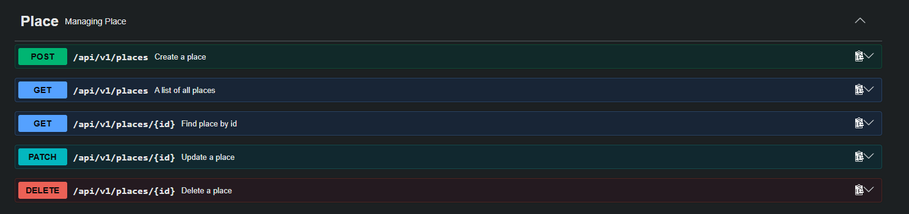
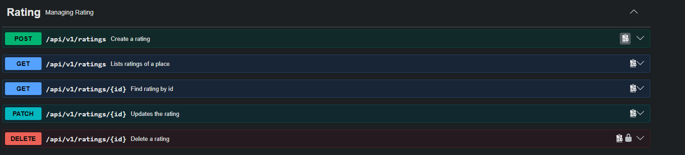
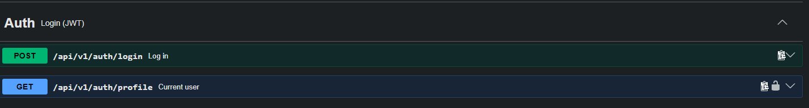

# CampusRate API

REST API which allows student to rate and consulte places on the campus.
Built with NestJS, TypeScript, MongoDB (Mongoose) and documented with Swagger/OpenAPI.

## 1. Project setup

Requirements: Node.js (LTS), npm, and a MongoDB database (MongoDB Atlas, see below).

```bash
npm ci
npm install
```

## 2. Configurations

Copy the example and fill in your values:

```bash
cp .env.example .env
```

<ul>
  <li>PORT: the port of the API</li>
  <li>MONGO_DOMAIN: the domain of the API</li>
  <li>MONGO_USERNAME: mongodb </li>
  <li>MONGO_PASSWORD: mongodb password</li>
  <li>MONGO_DB: mongodb database name</li>
  <li>JWT_SECRET: Secret used to sign JWT</li>
</ul>

Generate a secret:

```bash
node -e "console.log(require('crypto').randomBytes(32).toString('hex'))"
```

## 3. Run the project

```bash
# install
npm install
# development
npm run start
# watch mode
npm run start:dev
# production
npm run start:prod     

npm run lint
```

## 4. Swagger

- Swagger UI: http://localhost:3000/api/v1/docs

## 5. Routes Contract

### Place


### Rating


### Auth


## 6. Structure of project

```
energy-api/
├── src/
    auth/
    ├── dto/
    ├── login.dto.ts
    └── token.dto.ts
    jwt/
    ├── jwt-auth.guard.ts
    └── jwt.strategy.ts
    ├── auth.controller.ts
    ├── auth.module.ts
    └── auth.service.ts
├── commun/
    ├── http.filter.ts
    ├── json.content-type-guards.ts
    ├── logger.middleware.ts    
    ├── mongo-error.ts
    ├── page.details-dto.ts
    └── problem.detail-dto.ts
├── config/
    ├── configure-http.ts
    ├── configure-swagger.ts
    └── database.config.ts
├── place/
    ├── dto/
    ├── update.place.dto.ts
    └── create.place.dto.ts
├── entities/
    └── place.entity.ts
├── schema/
    └── place.schema.ts
    ├── place.controller.ts
    ├── place.module.ts
    ├── place.repository.ts
    └── place.service.ts
├── rating/
    ├── dto/
    ├── create.rating.dto.ts
    ├── update.rating.dto.ts
├── entities/
    └── rating.entity.ts
├── schema/
    └── rating.entity.ts
    ├── rating.controller.ts
    ├── rating.module.ts
    ├── rating.repository.ts
    └── rating.service.ts
├── app.module.ts
├── main.ts
├── test/
├── .gitignore
├── README.md
├── .env.example
├── nest-cli.json
├── package.json
├── package-lock.json
├── tsconfig.build.json
└── tsconfig.json
```
## 7. Optionnal Function

<ul>
  <li>M1, M2 et M3 (une fonction pour calculer le total des ratings)</li>
  <li>H1,H2,H3,H4,H5</li>
  <li>L1, A1 JWT</li>
</ul>
